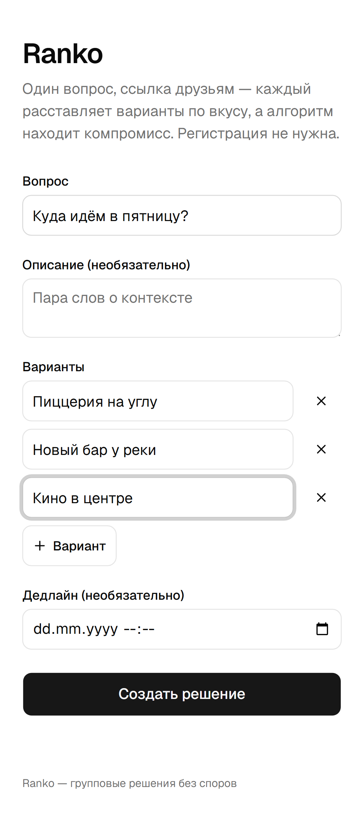
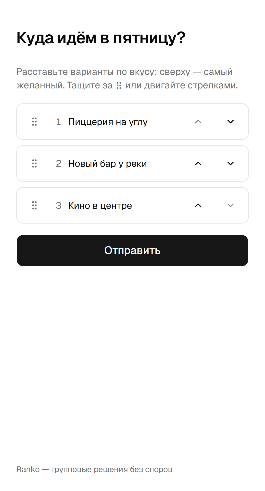
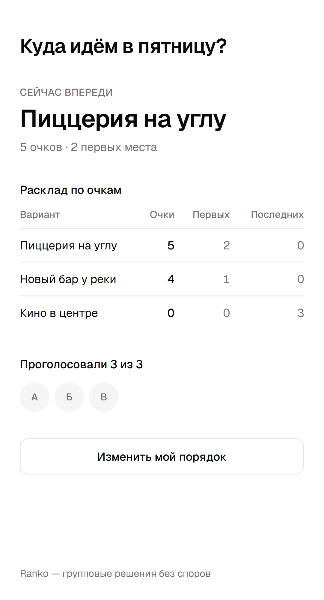

# Ranko

Групповые решения без сорока сообщений «ну а ты что хочешь?».

**Демо:** https://ranko-delta.vercel.app

Один человек заводит вопрос с вариантами и кидает ссылку в чат. Каждый расставляет варианты по
порядку прямо в браузере телефона, без регистрации и приложения. Ranko считает победителя
и показывает, почему победил именно он.

## Зачем

Когда в общем чате выбирают ресторан или фильм, побеждает тот, кто дольше всех спорит. Обычный
опрос тоже не помогает: он считает только первые места. Вариант может набрать больше всех голосов
и при этом стоять последним у половины чата.

В Ranko каждый ранжирует все варианты, и в подсчёт идёт весь порядок, а не только первое место.

## Как выглядит

| Создать | Проголосовать | Результаты |
|---|---|---|
|  |  |  |

Скриншоты снимает `npm run screenshots`: скрипт проходит путь человека (создать → проголосовать →
результаты) на запущенном приложении.

## Как считается победитель

Метод Борда. Участнику его можно объяснить одной фразой:

> Вариант получает тем больше очков, чем выше он в твоём списке. Побеждает тот, у кого сумма больше.

При N вариантах вариант на позиции k получает `N − k` очков: верхний `N − 1`, нижний `0`.
Ничьи разводятся по порядку: больше первых мест, потом меньше последних мест, потом
детерминированный выбор по хэшу от slug решения. Хэш нужен, чтобы при равенстве победитель
не менялся при каждом обновлении страницы результатов.

Поэтому вариант, который никто не поставил первым, но и никто не задвинул в конец, обходит
вариант, который нравится меньшинству. Алгоритм лежит в [src/lib/borda.ts](src/lib/borda.ts)
чистой функцией и покрыт тестами, включая тай-брейки и случаи с 0 и 1 участником.

### Почему Борда, а не другие методы

- **Обычный опрос** смотрит только на первые места. Это та проблема, которую Ranko решает.
- **Мгновенный второй тур (IRV)** по очереди выбрасывает вариант с наименьшим числом первых мест.
  Компромиссный вариант, который у всех второй, вылетает раньше остальных. Для выбора «куда
  пойдём всей компанией» это ровно обратное тому, что нужно.
- **Метод Кондорсе** ищет вариант, который выигрывает у каждого в парных сравнениях. Такого
  варианта может не быть (A > B > C > A), и тогда нужен второй метод поверх. Объяснить результат
  участнику одной фразой уже не получится.
- **Борда** всегда даёт победителя, учитывает весь порядок и объясняется одной фразой. Слабое
  место: им можно играть, специально задвигая главного конкурента в конец. Для выбора пиццерии
  среди друзей я счёл это приемлемым.

## Решения и компромиссы

- **Варианты замораживаются после первого голоса.** Если добавить или удалить вариант, уже
  отправленные ранжировки перестают быть полными, и их сумма теряет смысл. Ручки, которая меняла бы
  набор вариантов, нет, и отдельный тест следит, чтобы она не появилась.
- **Каждый ранжирует все варианты.** Список приходит уже упорядоченным, достаточно подвинуть
  то, что важно. Так не нужно придумывать очки для неупорядоченного хвоста.
- **Драг и стрелки ↑/↓.** При двадцати вариантах на телефоне перетаскивание конфликтует со
  скроллом, поэтому у каждой карточки есть стрелки. Обе кнопки ведут в одну и ту же перестановку,
  и со стрелками удобнее работать с клавиатуры и скринридера.
- **Дедлайн закрывается лениво.** Крона нет: любое чтение или запись решения после дедлайна сначала
  переводит его в статус «закрыто».
- **Аккаунтов нет.** Право админа — это знание `adminToken` из админской ссылки, его сравнение идёт
  за постоянное время. Участника узнаём по токену в localStorage и по httpOnly-cookie на случай,
  если localStorage вычистили. Cookie выставлена с `SameSite=Lax`: по ней сервер принимает голос,
  и без этого флага чужой сайт мог бы проголосовать от имени участника. Токены не логируются и не попадают
  в GET-ответы.
- **Поллинг вместо realtime.** Страница результатов опрашивает сервер раз в 4 секунды через SWR.
  Для голосования на несколько минут этого хватает, а вебсокеты на Vercel потребовали бы отдельный
  сервис.
- **Neon HTTP вместо TCP-`pg`.** На Vercel каждая serverless-функция открывает своё соединение,
  и обычный пул быстро упирается в лимит соединений Postgres.
- **Места без Геосаджеста.** Место варианта — это ссылка из «Поделиться» Яндекс.Карт или адрес
  текстом. API Геосаджеста я не подключил: поддержка Яндекса подтвердила (июль 2026), что на
  бесплатном тарифе хранить полученные через API данные нельзя, а коммерческая лицензия стоит от
  180 000 ₽ в год. Ссылку, которую админ вставил руками, это ограничение не касается.

## Стек

| Слой | Выбор |
|---|---|
| Фреймворк | Next.js (App Router) + TypeScript strict |
| UI | Tailwind CSS + shadcn/ui, mobile-first |
| Drag & drop | dnd-kit + кнопки ↑/↓ |
| БД | Postgres (Neon) + Drizzle ORM, миграции drizzle-kit |
| Валидация | zod на каждой границе API |
| Данные на клиенте | SWR с поллингом раз в 4 секунды |
| Тесты | Vitest (юниты и ручки на PGlite) + Playwright (сквозной сценарий) |
| Деплой | Vercel |

## Приватность

Аналитики и сторонних счётчиков нет, поэтому нет и баннера про cookies. Единственная cookie —
httpOnly-токен участника, привязанный к конкретному решению.

## Локальный запуск

Нужен Node 20+ и база Postgres (проще всего — бесплатный проект в [Neon](https://neon.tech)).

```bash
npm install
cp .env.example .env.local   # и подставить DATABASE_URL
npx drizzle-kit migrate      # накатить схему
npm run db:seed              # необязательно: демо-решение на /d/demo-fri
npm run dev
```

Открыть http://localhost:3000.

## Переменные окружения

Все описаны с комментариями в [.env.example](.env.example). Обязательная одна:

| Переменная | Обязательна | Зачем |
|---|---|---|
| `DATABASE_URL` | да | Postgres (Neon), pooled-строка |
| `NEXT_PUBLIC_SITE_URL` | в проде | Абсолютный адрес для ссылок на OG-превью |
| `UPSTASH_REDIS_REST_URL` / `_TOKEN` | в проде | Rate limit на создание, общий для всех инстансов. Без них лимит живёт в памяти процесса, и на Vercel каждый инстанс считает своё |
| `NEXT_PUBLIC_FEEDBACK_EMAIL` | нет | Почта для ссылки «Написать автору». Пусто — ссылки нет |

## Команды

```bash
npm run dev          # dev-сервер
npm run lint         # eslint
npm run typecheck    # tsc --noEmit
npm run test         # vitest: юниты + ручки на PGlite в памяти
npm run test:e2e     # playwright: сквозной сценарий (нужен dev-сервер и живая база)
npm run metrics      # метрики продукта по базе (см. ниже)
npm run screenshots  # переснять картинки для README (нужен dev-сервер)
npm run db:generate  # сгенерировать миграцию по изменённой схеме
npm run db:migrate   # накатить миграции
npm run db:seed      # демо-решение
```

## Деплой

Vercel + Neon, своего сервера нет.

1. Завести проект в Neon, скопировать **pooled**-строку подключения.
2. Импортировать репозиторий в Vercel. Next.js определится сам.
3. Прописать переменные окружения (таблица выше). `NEXT_PUBLIC_SITE_URL` — боевой адрес: без него
   превью-деплои подставляют в OG-разметку свои временные адреса.
4. Накатить схему на прод-базу: `DATABASE_URL=<прод> npx drizzle-kit migrate`.
5. Проверить вручную: создать решение, отправить ссылку в мессенджер (развернулось ли OG-превью),
   проголосовать с телефона.

## Метрики

`npm run metrics` считает по базе три числа: сколько решений создано, в скольких проголосовали
трое и больше, сколько дошло до статуса «закрыто». Продукт работает, если решения доводят до конца,
а это видно по базе без внешнего счётчика.

## Что дальше

В v0.1 сознательно не вошли: опросы по датам, право вето, предложение вариантов участниками,
делёжка расходов, Telegram-бот, аккаунты и история решений.
